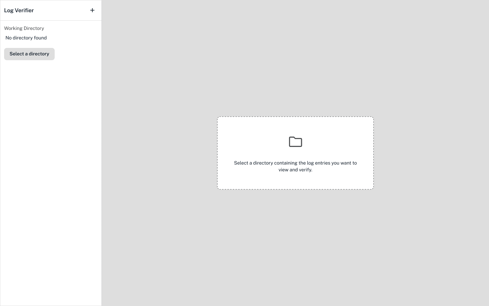
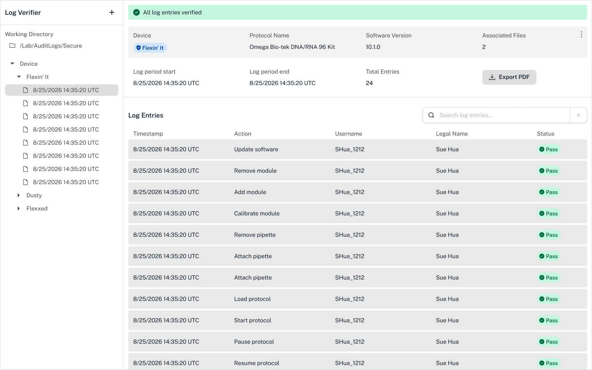

It's important to be able to download, view, understand, and safely store the audit logs your compliance ready Flex generates. Since these, like other robot files, are difficult for humans to read, you can use the Opentrons log verifier to view audit logs. 

!!! note
    The log verifier is a separate app. You can download it from [Opentrons](https://opentrons.com/software). 

## Setup

After you download the log verifier, you'll need to choose the directory with your audit logs. You can configure the [default storage location](../settings.md#download-folder) in the Opentrons App.

<figure class="screenshot" markdown>
  
  <figcaption>Click on the left to choose the directory containing your audit logs.</figcaption>
</figure> 

If you need to choose a new directory, click the :material-plus: at the top left.

!!! note
    Audit logs download as a `.zip` from the [file manager](files.md#file-manager). To view them in the log verifier, expand the `.zip` file into a folder first. You can then select that folder to view in the log verifier. 

    You can't select individual log periods within that folder to view. 

When you look at a robot's audit logs for the first time, you'll also need to  authorize that robot's identity. The log verifier will prompt you to review your robot's name, serial number, and certificate. Click **Trust this robot** to continue. 

## View a log period 

Click to expand the **Devices** list on the left and choose your robot. Then, choose a log period. 

<figure class="screenshot" markdown>
  
  <figcaption>View a log period and its entries in the log verifier.</figcaption>
</figure> 

Each log period contains actions, or log entries, completed during that period. Here, each row shows: 

* A UTC timestamp for the action. 
* A phrase describing the action, like "Start update session" for a software update.
* The username and legal name of the user responsible for the action.
* The action's status (pass or fail). 

< insert text about what it means to pass or fail >

Click any individual log entry to view in its own page. Here, you'll see additional information about the action:

* The **reason** for the action, or the [user's documentation](documentation.md).
* Additional compliance-ready information, like an entry hash and signature. 