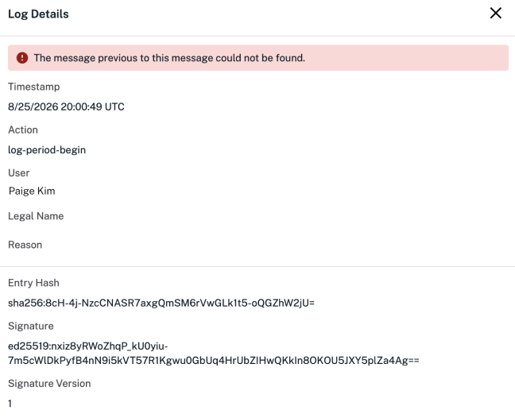
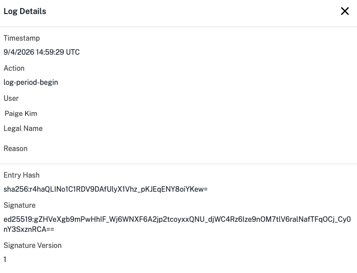

Your compliance ready Flex captures important protocol data in audit logs. It's important to be able to verify that data for your lab's records. Since these, like other robot files, can be difficult for humans to read, you can use the Opentrons Log Verifier App to verify this protocol data in audit logs and log periods.  

!!! note
    The Opentrons Log Verifier App is separate from the Opentrons App you use to control your Flex. You can download the Log Verifier App from [the Opentrons website](https://opentrons.com/compliance-ready-software).

The audit logs and other files your Flex generates are never viewed or stored by Opentrons. It's your lab's responsibility to manage these files, including downloading and storing in a secure location. The Opentrons Log Verifier App never stores your files, and can only be used for understanding and verifying your audit logs.

## Setup

After you download the Log Verifier App, you'll need to choose the directory containing your audit logs. You can configure a [default storage location](../settings.md#download-folder) for files you download in the Opentrons App.

<figure class="screenshot" markdown>
  
  <figcaption>Click on the left to choose the directory containing your audit logs.</figcaption>
</figure> 

If you need to choose a new directory, click the :material-plus: at the top left.

Remember that your audit logs are grouped together and downloaded in a *log period*. Log periods end after the Flex completes each protocol run or whenever the Flex boots, like after a robot software update.

You can download one or more log periods as a `.zip` file from the Opentrons App or Flex touchscreen. To view them in the Log Verifier App, first expand the `.zip` file into a folder. Then, choose the folder as your directory to view all the log periods in the app. 

When you look at a robot's audit logs for the first time, you'll also need to  authorize that robot's identity. The Log Verifier App will prompt you to review your robot's name, serial number, and certificate. Click **Trust this robot** to continue. 

## View a log period 

Click to expand the **Devices** list on the left and choose your robot. Then, choose a log period. 

<figure class="screenshot" markdown>
  
  <figcaption>View a log period and its entries in the log verifier.</figcaption>
</figure> 

Each log period contains actions, or log entries, completed during that period. Here, each row shows: 

* A UTC timestamp for the action. 
* A phrase describing the action, like "Start update session" for a software update.
* The username and legal name of the user responsible for the action.
* The action's status (pass or fail).

For your records, you can click **Export PDF** to export this protocol data.

Every log entry within a period is labeled with a "pass" in green or a "fail" in red. When every entry in your log period has all the data it should, it passes and is verified. 

A failing log entry means that not every piece of protocol data can be accounted for in the audit log. In these cases, you should not consider your audit log to be verified.

<figure class="screenshot" markdown>
  
  <figcaption>Failing log entries include a message in the Log Verifier App.</figcaption>
</figure> 

In the example above, the failing message shown in red could mean that a user logged out before signing for the run or entering documentation, or that your Flex lost power or connection to the network. This audit log is missing protocol data and cannot be verified.

## View log details

Click any individual log entry to view in its own page.

<figure class="screenshot" markdown>
  
  <figcaption>View additional log entry details.</figcaption>
</figure>

Here, you'll see additional information about the action:

* The **reason** for the action, or the [user's documentation](documentation.md).
* Additional compliance-ready information, like an entry hash and signature.