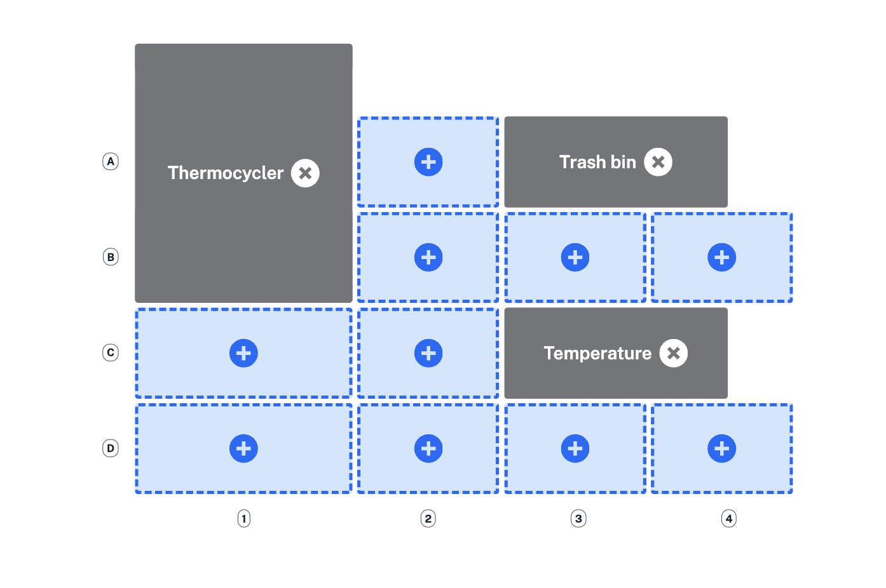

Adding modules and deck fixtures expands the functionality and capabilities of your Opentrons robot. Protocol Designer automatically enforces slot compatibility and prevents hardware conflicts as you place these modules and fixtures on the deck.

## Adding hardware

The second step in building your protocol is to add modules or fixtures to the deck. Click an open slot to add a module, like the Temperature Module, or a fixture like the trash bin.

<figure class="screenshot" markdown>
  
  <figcaption>Click an open Flex deck slot to add compatible modules and fixtures.</figcaption>
</figure>

## Module compatibility

Protocol Designer protocols can control Opentrons modules on the Flex or OT-2, as shown below. Flex lets you use multiple modules of the same type, except for the Thermocycler.

<table>
  <thead>
    <tr>
      <th>Module</th>
      <th>Opentrons Flex</th>
      <th>Opentrons OT-2</th>
    </tr>
  </thead>
  <tbody>
    <tr>
      <td><strong>Thermocycler Module</strong></td>
      <td>
        <ul>
          <li>Only 1 module</li>
          <li>GEN2 only</li>
          <li>Slots A1 and B1</li>
        </ul>
      </td>
      <td>
        <ul>
          <li>Only 1 module</li>
          <li>GEN1 or GEN2</li>
          <li>Slots 7 and 10</li>
        </ul>
      </td>
    </tr>
    <tr>
      <td><strong>Heater-Shaker Module</strong></td>
      <td>
        <ul>
          <li>Up to 7 modules</li>
          <li>GEN1 only</li>
          <li>Slots A1–D1 or A3–D3</li>
        </ul>
      </td>
      <td>
        <ul>
          <li>Only 1 module</li>
          <li>GEN1 only</li>
          <li>Slot 1, 3, 4, 6, 7, or 10</li>
        </ul>
      </td>
    </tr>
    <tr>
      <td><strong>Absorbance Plate Reader Module</strong></td>
      <td>
        <ul>
          <li>1 module only</li>
          <li>GEN1 only</li>
          <li>Slots A3–D3</li>
        </ul>
      </td>
      <td>Not compatible</td>
    </tr>
    <tr>
      <td><strong>Magnetic Block</strong></td>
      <td>
        <ul>
          <li>Up to 11 modules</li>
          <li>GEN1 only</li>
          <li>Slots A1–D3</li>
        </ul>
      </td>
      <td>Not compatible</td>
    </tr>
    <tr>
      <td><strong>Magnetic Module</strong></td>
      <td>Not compatible</td>
      <td>
        <ul>
          <li>1 module only</li>
          <li>GEN1 or GEN2</li>
          <li>Slot 1, 3, 4, 6, 7, 9, or 10</li>
        </ul>
      </td>
    </tr>
    <tr>
      <td><strong>Temperature Module</strong></td>
      <td>
        <ul>
          <li>Up to 7 modules</li>
          <li>GEN2 only</li>
          <li>Slots A1–D1 or A3–D3</li>
        </ul>
      </td>
      <td>
        <ul>
          <li>1 module only</li>
          <li>GEN1 or GEN2 only</li>
          <li>Slot 1, 3, 4, 6, 7, 9, or 10</li>
        </ul>
      </td>
    </tr>
    <tr>
      <td><strong>Flex Stacker Module</strong></td>
      <td>
        <ul>
          <li>Up to 4 modules</li>
          <li>GEN1 only</li>
          <li>Slots A4–D4</li>
        </ul>
      </td>
      <td>Not compatible</td>
    </tr>
    <tr>
      <td><strong>Vacuum Module</strong></td>
      <td>
        <ul>
          <li>Only 1 module</li>
          <li>GEN1 only</li>
          <li>Slots A3–A4 only (dual-slot deck adapter)</li>
        </ul>
      </td>
      <td>Not compatible</td>
    </tr>
  </tbody>
</table>

## Fixture compatibility

To optimize deck space on the Flex, you can also customize fixtures such as the waste chute, trash bin, and staging areas.

Click **Deck hardware** in the left sidebar, then click :material-plus-circle: on a compatible slot to add a fixture.

<table>
  <thead>
    <tr>
      <th>Fixture</th>
      <th>Opentrons Flex</th>
      <th>Opentrons OT-2</th>
    </tr>
  </thead>
  <tbody>
    <tr>
      <td><strong>Trash Bin</strong></td>
      <td>
        <ul>
          <li>Only 1 trash bin</li>
          <li>Slots A1–D1 or A3–D3</li>
        </ul>
      </td>
      <td>
        <ul>
          <li>Only 1 trash bin</li>
          <li>Slot 12</li>
        </ul>
      </td>
    </tr>
    <tr>
      <td><strong>Waste Chute</strong></td>
      <td>
        <ul>
          <li>Only 1 waste chute</li>
          <li>Slot D3</li>
        </ul>
      </td>
      <td>Not compatible</td>
    </tr>
    <tr>
      <td><strong>Staging area</strong></td>
      <td>
        <ul>
          <li>Up to 4 staging areas</li>
          <li>Slots A4–D4</li>
        </ul>
      </td>
      <td>Not compatible</td>
    </tr>
  </tbody>
</table>

!!! tip
    You can create additional space on the Flex deck by adding as many as four staging areas in slots A4-D4.

## Preventing hardware conflicts

Protocol Designer automatically adjusts your deck hardware to avoid conflicts. For example, some Flex modules, like the Temperature and Heater-Shaker Modules, can't be placed in column 3 next to a Stacker Module in column 4.

Similarly, the Vacuum Module adapter requires two deck slots, A3 and A4. Because Protocol Designer places the Trash Bin in slot A3 by default, you must remove it to make this location available for the Vacuum Module deck adapter. If your protocol requires waste handling, you can move the bin to another location on the deck or attach the [external Waste Chute](https://opentrons.com/products/opentrons-flex-waste-chute-gen2-1yok) to your Flex.