When you add modules to the robot deck, available module steps appear in the "Add step" menu. Protocol Designer supports the use of the following modules:

| Module and generation | Opentrons Flex | Opentrons OT-2 |
| --------------------- | :--------------: | :--------: |
| Absorbance Plate Reader Module GEN1 | :octicons-check-16: | :octicons-x-16: |
| Flex Stacker Module GEN1 | :octicons-check-16: | :octicons-x-16: |
| Heater-Shaker Module GEN1 | :octicons-check-16: | :octicons-x-16: |
| Magnetic Module GEN1 | :octicons-x-16: | :octicons-check-16: |
| Magnetic Module GEN2 | :octicons-x-16: | :octicons-check-16: |
| Magnetic Block GEN1 | :octicons-x-16: | :octicons-check-16: |
| Temperature Module GEN1 | :octicons-x-16: | :octicons-check-16: |
| Temperature Module GEN2 | :octicons-check-16: | :octicons-check-16: |
| Thermocycler Module GEN1 | :octicons-x-16:| :octicons-check-16: |
| Thermocycler Module GEN2 | :octicons-check-16: | :octicons-check-16: |
| Vacuum Module GEN1 |  :octicons-check-16: | :octicons-x-16: |

You can add multiple modules of the same type only on the Flex. However, both robots are limited to a single Thermocycler.

## Absorbance Plate Reader Module steps

You'll need a Flex Gripper to add an Absorbance Plate Reader Module to your protocol starting deck. To prevent damage, only the gripper can move the lid on and off the Absorbance Plate Reader. The gripper automatically places the lid to the right of the plate reader, in deck column 4.

To use an Absorbance Plate Reader Module in a Protocol Designer protocol, you'll need to initialize the Plate Reader, move a plate to the module, and read the plate using your chosen wavelength settings.

Follow the instructions to add a total of six Absorbance Plate Reader steps to your protocol.

1. Add an Absorbance Plate Reader step to close the lid. In the step form, click to **Change lid position**. Click **Continue** and use the toggle switch to change the lid position from open to closed. The gripper will close the lid with no labware inside.

2. Use a second Absorbance Plate Reader step to initialize the module. Click **Define initialization settings** and choose a single or multiple initialization wavelengths from the dropdown menu. 
    Custom wavelengths between 350–1000 nanometers are supported. When using a single wavelength, you can add a reference wavelength for normalization or to correct for background interference. Your chosen settings appear as the current initialization settings when you add another Absorbance Plate Reader step.
    
    !!! Note
        To initialize the Absorbance Plate Reader, the module must be empty with the lid closed. Remove any labware and use a Plate Reader step to close the lid.

    <figure class="screenshot" markdown>
    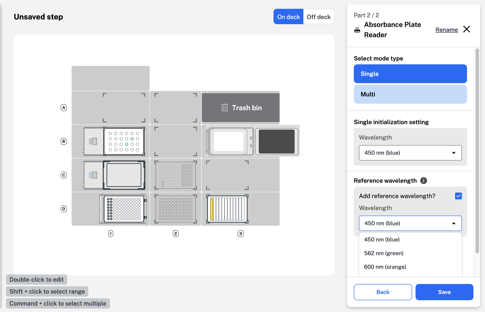
   <figcaption>Add a single initialization and a reference wavelength in a Plate Reader step.</figcaption>
2. Use a second Absorbance Plate Reader step to initialize the module. Click **Define initialization settings** and choose a single or multiple initialization wavelengths from the dropdown menu.

    !!! tip "Reminder"
        To initialize the Absorbance Plate Reader, the module must be empty with the lid closed. Remove any labware and use a Plate Reader step to close the lid.

    <figure class="screenshot" markdown>
    
    <figcaption>Add a single initialization and a reference wavelength in a Plate Reader step.</figcaption>
    </figure>

    !!! note
        Custom wavelengths between 350–1000 nanometers are supported. When using a single wavelength, you can add a reference wavelength for normalization or to correct for background interference. Your chosen settings appear as the current initialization settings when you add another Absorbance Plate Reader step.

3. Add an Absorbance Plate Reader step to open the lid using the gripper. The Plate Reader lid must be open to add labware to the module.

4. Use a move step to move your plate to the Absorbance Plate Reader. You can add labware to the module manually or using the gripper.

    Most 96-well plates from the Opentrons [Labware Library](https://labware.opentrons.com "Labware Library") are supported.

5. Add an Absorbance Plate Reader step to read the plate in the module. Click **Read labware** to collect absorbance data for the samples in your plate.

    **Read labware** is only available if the Plate Reader is initialized, with a plate inside and the lid closed.

6. Enter a name for your CSV file. You can find this file and any previous Absorbance Plate Reader data in your robot's recent protocol runs in the Opentrons App.

    Data from this CSV file can be used in your Python protocols created outside of Protocol Designer.

    After reading your plate, follow the same steps to open the lid, remove the plate, and close the Absorbance Plate Reader lid with the gripper.

Protocol Designer includes Absorbance Plate Reader step details to help you keep track of all six steps. Hover over each step in the timeline to view details below the deck map.

## Flex Stacker Module steps

Click **Add Step** in the bottom left to add a Stacker step to your Protocol Designer protocol. The step menu on the right shows the labware currently in the Flex Stacker and any labware on the attached shuttle.

<figure class="screenshot" markdown>
  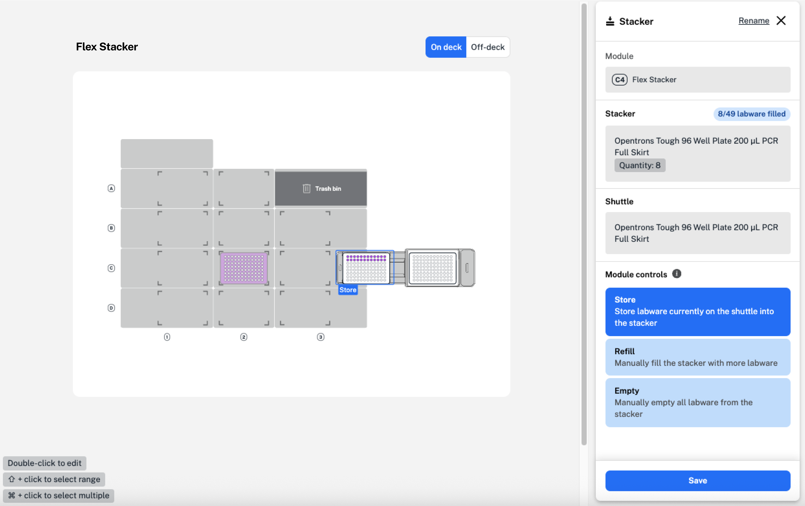
  <figcaption>Add a Stacker step to store or retrieve labware, or refill or empty your Flex Stacker.</figcaption>
</figure>

In the image above, labware on the shuttle and the top piece of labware in the Stacker are visible. Labware at the bottom of the stack can be moved to the shuttle, but you won't be able to see this labware on the Flex deck. Click the Stacker on the right side of the deck to view the labware stack.

In the step menu, choose from the available module controls to:

- **Retrieve** a single piece of labware loaded in the Stacker. The labware at the bottom of the stack will be moved onto the shuttle. Add a move step to transfer the labware elsewhere on the Flex deck, either manually or with the Flex Gripper. The shuttle must be empty to retrieve labware.
- **Store** a single piece of labware on the shuttle in the Stacker. The labware will be stored at the bottom of the stack.
- **Refill** the Stacker with the same type of labware originally loaded in the protocol starting deck. Select the labware type and quantity, and add an optional message to display on the Flex touchscreen.
- **Empty** all labware from the Stacker. Add an optional message to display on the Flex touchscreen.

Any labware filled into or emptied from the Stacker comes from the Flex's off-deck location, but you don't need to add it there yourself! When you add a refill or empty Stacker step, Protocol Designer creates the off-deck labware for you. Click the toggle switch at the top right of the deck view to see the off-deck labware at any point.

## Heater-Shaker Module steps

Adding a Heater-Shaker Module step to your protocol displays any labware and adapters currently on the module.

<figure class="screenshot" markdown>
  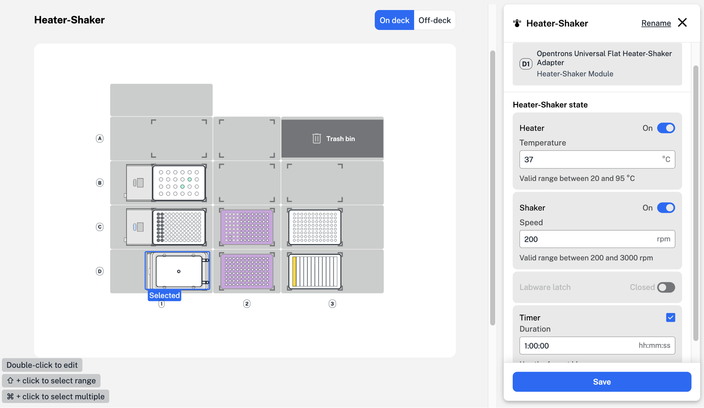
  <figcaption>Add a temperature, shake speed, and timer for a Heater-Shaker step.</figcaption>
</figure>

In this example, a Corning 96-well flat plate is placed on top of an Opentrons Universal Flat Heater-Shaker adapter. Both are on the Heater-Shaker in deck slot D1.

Before moving labware to or from the Heater-Shaker, make sure that the labware latch is open. Add a Heater-Shaker step that opens the labware latch before any step that moves labware to the Heater-Shaker. Without this step, a [timeline error](../warnings-errors.md#errors) could occur.

In the Heater-Shaker step form, set the heater or shaker functions to **On** and enter a custom value for temperature or shake speed. The Heater-Shaker module can heat samples between 20 °C,and 95 °C, and shake samples between 200 and 3000 rpm.

Set a custom time for your Heater-Shaker step by enabling the timer. The timer will begin after the Heater-Shaker reaches the target temperature or shaking speed.

If your Heater-Shaker step doesn't include a set time, Protocol Designer will automatically add a pause step to the timeline. Because reaching a target temperature takes more time than changing the shaking speed, this lets the Heater-Shaker reach a target temperature while your protocol proceeds to the next step.

!!! warning
    If you delete the pause step, your protocol won't check to make sure the Heater-Shaker reaches its target temperature. Especially short protocols could end before the module fully heats or cools.

After your Heater-Shaker step, follow the same steps to deactivate the temperature and shake functions, open the labware latch, and move your labware.

## Temperature Module steps

Adding a Temperature Module step to your protocol displays any labware and adapters currently on the module. Aluminum blocks or a deep well adapter can be used to add labware to the module. Click to set the module state and enter a temperature between 4 and 95 °C.

After your Temperature module step, add a second step to deactivate the module. Just like in a Heater-Shaker step, Protocol Designer will automatically add a pause step to make sure your Temperature Module reaches its set temperature.

## Thermocycler Module steps 

Adding a Thermocycler Module step to your protocol opens a two-part Thermocycler form. First, choose whether to change the state of the Thermocycler module or to program a profile. Changes to the module state include simple changes like opening the lid or setting an initial lid temperature, while programming a profile sets timed temperature cycles for your experiment.

!!! note
    When adding a Thermocycler Module step, labware in the module is not automatically displayed. Load labware in the Thermocycler on the protocol starting deck or move your labware to the Thermocycler module in a move step. To move labware to and from the Thermocycler, first open the lid by clicking **Change Thermocycler state**.

Click **Change Thermocycler state** to set a block or lid temperature, or to open or close the lid. You can set the block at any temperature between 4 and 99 °C and the lid at any temperature between 37 and 110 °C. 

Click **Program a Thermocycler profile** to choose parameters for your experiment. Start by entering values for your individual well volume and initial lid temperature. Click **No profile defined** to open the profile steps menu.

<figure class="screenshot" markdown>
  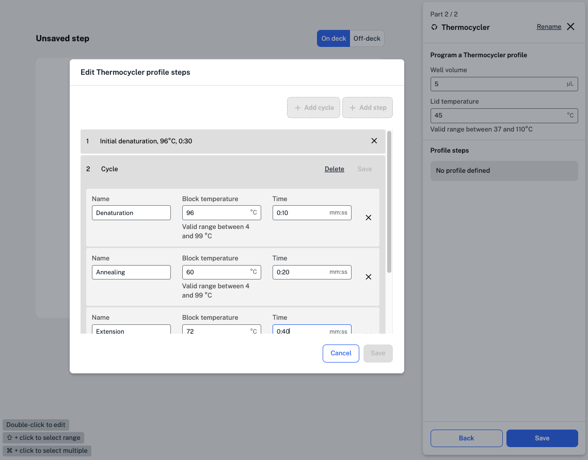
  <figcaption>Add a cycle of temperature holds within a Thermocycler step.</figcaption>
</figure>

Click **Add step** to create a step, like an initial denaturation, that only needs to happen once. Choose a block temperature, time, and name for your step.

Cycles are made up of steps that are repeated a set number of times in your experiment. Click **Add cycle** to add steps to a cycle. At the bottom of the menu, enter the number of times the cycle should repeat before saving your work.

Running Thermocycler profiles is time-consuming, so you can choose to run other protocols steps [in parallel](../steps/parallel.md) with your profiles.

## Vacuum Module steps

Adding a Vacuum Module step to your protocol lets you:

- **Manage labware and components:** Configure the module with any required labware, collars, and spacers. When working with an imported Protocol Designer file, this tool will also show you any installed spacers, collars, and other staged components.

- **Control vacuum operation:** Set the _state_ of the module through features that control a an individual step in a vacuum protocol, or create a _profile_ that lets you specify multiple operations within a single step.

To set up your Vacuum Module and add vacuum steps to a protocol, click **Edit protocol** from the module overview screen and:

* **Add hardware:** Click on the module's deck icon (slot A3 or A4). From the popup menu, select **Edit labware** to choose the filter plates, well plates, spacers, and collars that you want to use on the module.

* **Add steps:** Click **Add step** to open the step menu. From the popup menu, select **Vacuum** to change the module's state or profile and save those settings in a vacuum step.

### Vacuum state

A *state* step sets an single configuration on the Vacuum Module rather than running a multi-step sequence.

In the step menu, click **Change Vacuum state** to configure module actions:

* **Turn on the pump:** Run the pump using closed-loop gauge pressure (between 0 and -800 mbar) or open-loop pump power (between 1% and 100%).
* **Open the vent:** Open the release valve to vent the chamber and return the system to atmospheric pressure (0 mbar).
* **Set a duration:** _(Optional)_ Specify how long to run the pump (in mm:ss). When unselected, the pump runs continuously until a subsequent vacuum step changes the module's state.

If you need to run the pump sequentially with different vacuum or power settings, you can create multiple state steps. However, it may be more efficient to create a vacuum profile or cycle, which run multiple operations sequentially once or in a loop, both within a single step.

### Vacuum profiles

A vacuum profile is a multi-step sequence of module operations that run in order within a single protocol step. A vacuum profile is useful when used with a step that requires sequential changes, like incrementally increasing vacuum pressure, alternating between holding vacuum and venting, and running the pump at different rates.

When building a profile, choose one mode type only for the entire sequence of sub-steps:

* **Pressure mode:** This is a closed loop operation where you set target gauge pressures between 0 and -800 mbar. The module continuously monitors internal sensors to reach and maintain the desired vacuum pressure.

* **Power mode:** This is an open loop operation where you set the pump motor to run at a fixed percentage of its rated power.

<figure class="screenshot side-by-side" markdown>
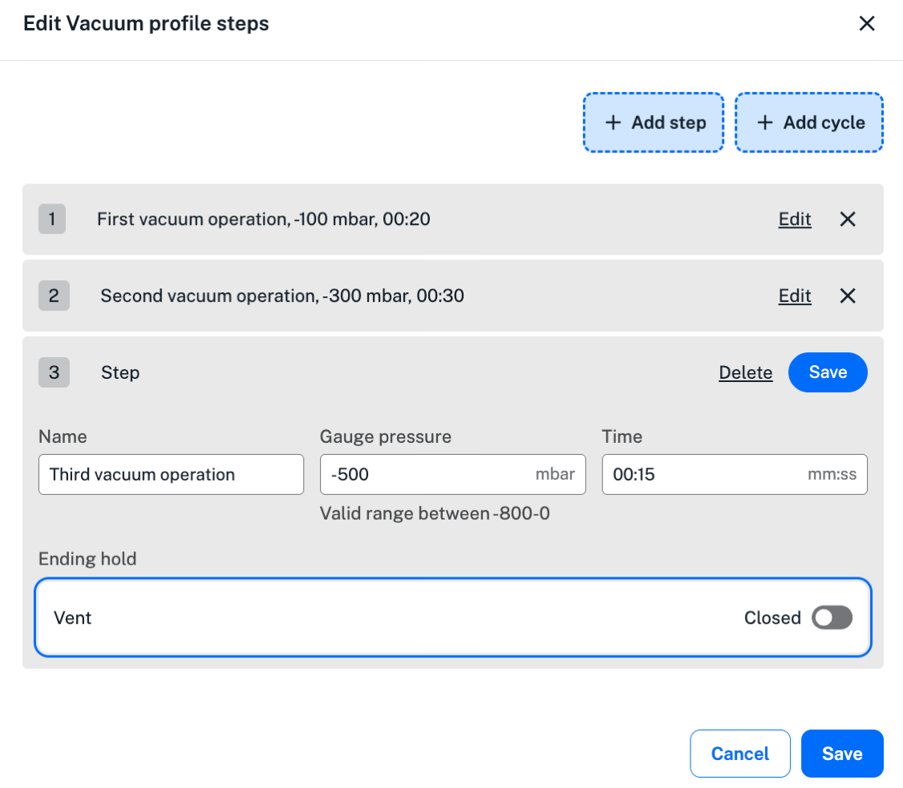
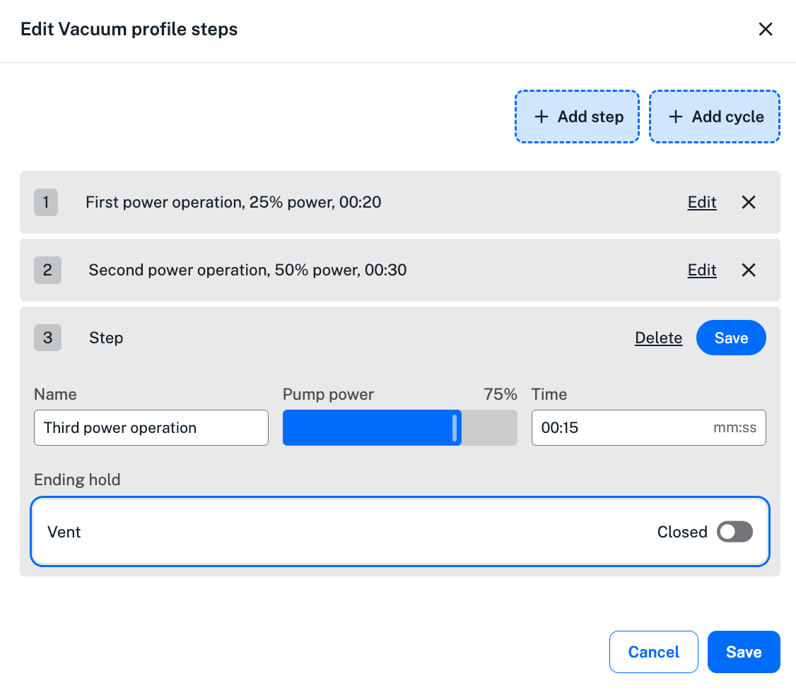
<figcaption>Pressure and power profiles showing multiple sub-steps.</figcaption>
</figure>

!!! tip
    See [Controlling vacuum operations](../../python-api/modules/vacuum.md#controlling-vacuum-operations) for more information about open and closed loop pressure controls.

### Vacuum cycles

Cycles are repeating loops of pressure or power operations nested within a vacuum step. While a standard vacuum profile step runs only once, a vacuum cycle repeats its sequence of operations for a set number of times before the robot moves on to the next protocol step.

<figure class="screenshot" markdown>
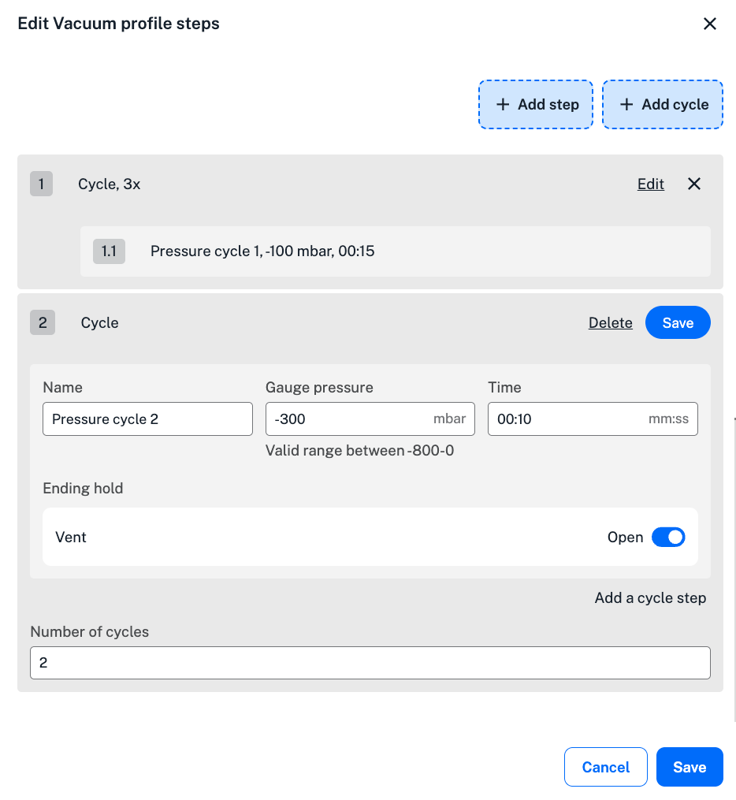{ width="80%" }
<figcaption>Vacuum profile with cyclical operations</figcaption>
</figure>

!!! tip
    You can combine profiles and cycles into a single vacuum profile, but the types (pressure or power) must be the same. Mixed pressure and power cycles and steps are not supported.

### Last module state

When working with pressure controls, the step menu includes a "Last module state" section. This is a read-only status indicator. It updates when a previous vacuum step changes the state of the module. For example, in the first vacuum step of a protocol, the module's state is **pump: off** and **vent: open**. If the step ends with the pump on and the vent closed, the next vacuum step will show the state as **pump: on** and **vent: closed**.

<figure class="screenshot" markdown>
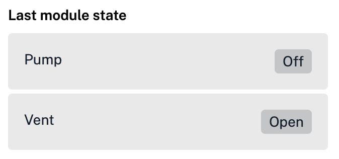{ width="60%" }
<figcaption>Shows module status from the previous vacuum step.</figcaption>
</figure>

## Unused test section

Testing with images from the step menu. Too complicated, I think.

<strong>REMOVE UNUSED IMAGES REMINDER</strong>

### Vacuum state image test 3

A *state* step sets a single pressure or power condition on the Vacuum Module rather than running a multi-step sequence.

Under **Select the state to change**, choose a primary action: change stat or program a profile. Here we only want to change state.

<figure class="screenshot" markdown>
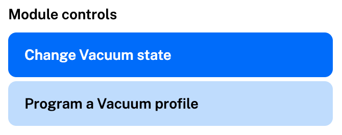{ width="60%" }
</figure>

Next, you can turn on the vacuum pump or open the vent (and save the step). Selecting the pump option opens the settings that let you specify vacuum pressure, duration, and vent open/closed slider (not shown).

<figure class="screenshot side-by-side" markdown>
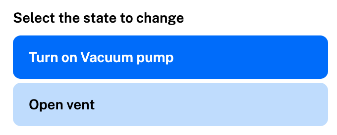
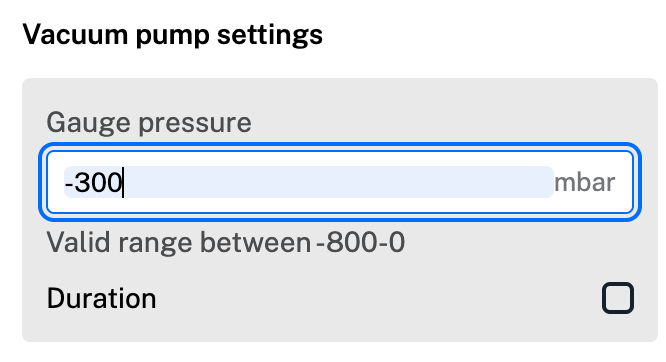
</figure>

### Vacuum state image test 2

A *state* step sets a single pressure or power condition on the Vacuum Module rather than running a multi-step sequence.

In the step menu, configure:

* **Module action:** Choose whether to turn the pump on or open the vent valve.
* **Control mode:** Select closed-loop **Gauge pressure** (0 to -800 mbar) or open-loop **Pump power** (1–100%).
* **Duration:** Run continuously until the next command or set an optional hold time (`mm:ss`).

<figure class="screenshot" markdown>
  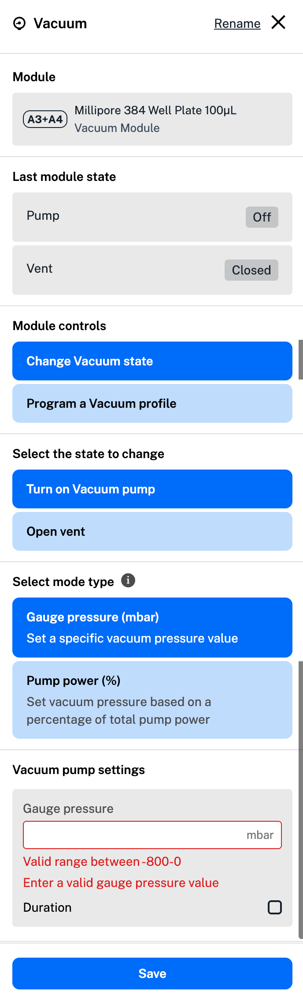
  <figcaption>Vacuum step menu configured for a state change.</figcaption>
</figure>

