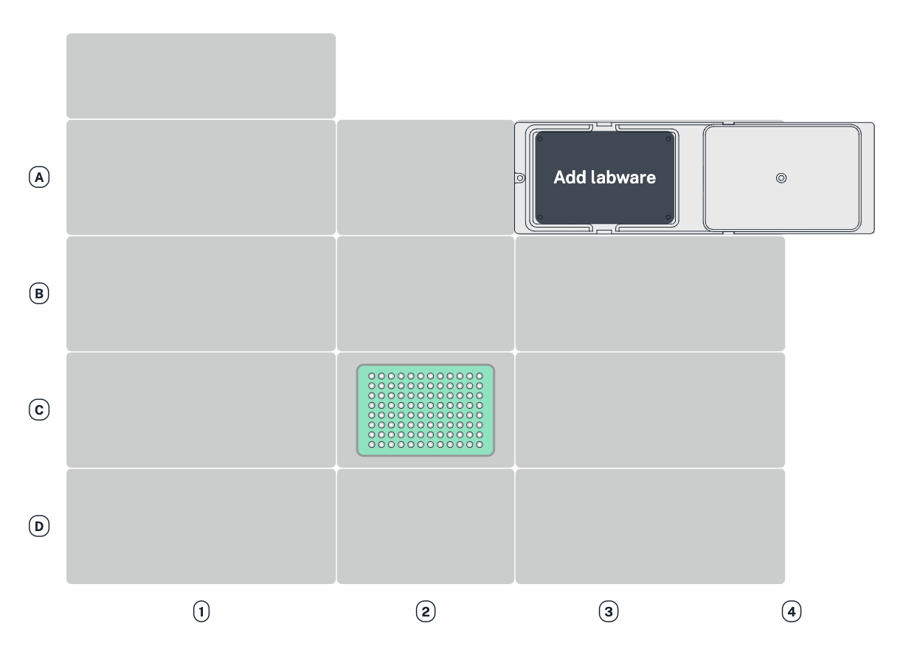
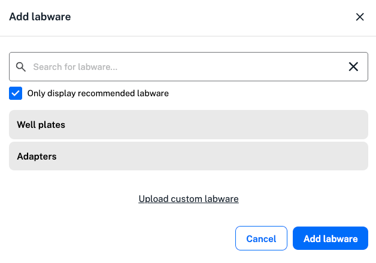
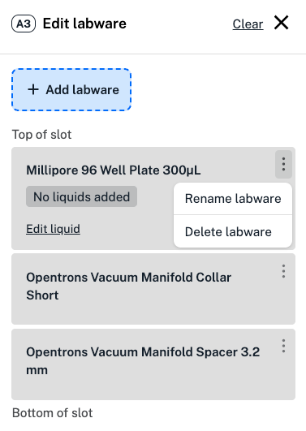
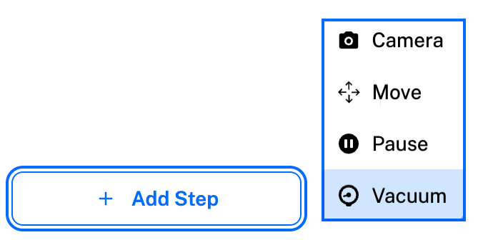
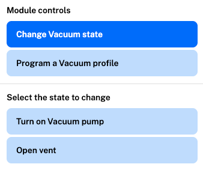
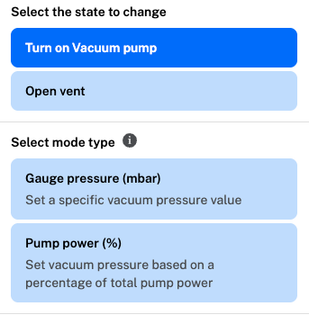
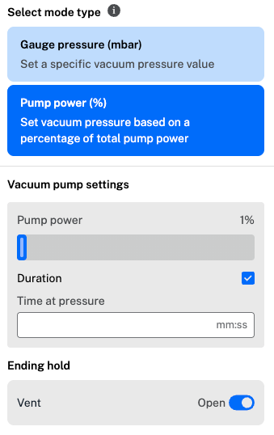
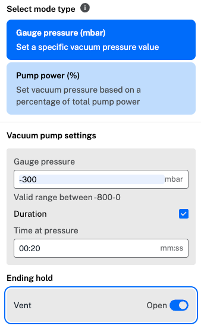
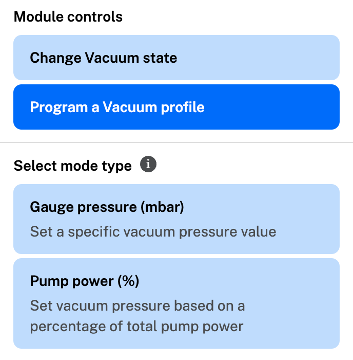

When you add modules to the robot deck, available module steps appear in the "Add step" menu. Protocol Designer supports the use of the following modules:

| Module and generation | Opentrons Flex | Opentrons OT-2 |
| --------------------- | :--------------: | :--------: |
| Absorbance Plate Reader Module GEN1 | :octicons-check-16: | :octicons-x-16: |
| Flex Stacker Module GEN1 | :octicons-check-16: | :octicons-x-16: |
| Heater-Shaker Module GEN1 | :octicons-check-16: | :octicons-x-16: |
| Magnetic Module GEN1 | :octicons-x-16: | :octicons-check-16: |
| Magnetic Module GEN2 | :octicons-x-16: | :octicons-check-16: |
| Magnetic Block GEN1 | :octicons-x-16: | :octicons-check-16: |
| Temperature Module GEN1 | :octicons-x-16: | :octicons-check-16: |
| Temperature Module GEN2 | :octicons-check-16: | :octicons-check-16: |
| Thermocycler Module GEN1 | :octicons-x-16:| :octicons-check-16: |
| Thermocycler Module GEN2 | :octicons-check-16: | :octicons-check-16: |
| Vacuum Module GEN1 |  :octicons-check-16: | :octicons-x-16: |

You can add multiple modules of the same type only on the Flex. However, both robots are limited to a single Thermocycler.

## Absorbance Plate Reader Module steps

You'll need a Flex Gripper to add an Absorbance Plate Reader Module to your protocol starting deck. To prevent damage, only the gripper can move the lid on and off the Absorbance Plate Reader. The gripper automatically places the lid to the right of the plate reader, in deck column 4.

To use an Absorbance Plate Reader Module in a Protocol Designer protocol, you'll need to initialize the Plate Reader, move a plate to the module, and read the plate using your chosen wavelength settings.

Follow the instructions to add a total of six Absorbance Plate Reader steps to your protocol.

1. Add an Absorbance Plate Reader step to close the lid. In the step form, click to **Change lid position**. Click **Continue** and use the toggle switch to change the lid position from open to closed. The gripper will close the lid with no labware inside.

2. Use a second Absorbance Plate Reader step to initialize the module. Click **Define initialization settings** and choose a single or multiple initialization wavelengths from the dropdown menu. 
    Custom wavelengths between 350–1000 nanometers are supported. When using a single wavelength, you can add a reference wavelength for normalization or to correct for background interference. Your chosen settings appear as the current initialization settings when you add another Absorbance Plate Reader step.
    
    !!! Note
        To initialize the Absorbance Plate Reader, the module must be empty with the lid closed. Remove any labware and use a Plate Reader step to close the lid.

    <figure class="screenshot" markdown>
    
   <figcaption>Add a single initialization and a reference wavelength in a Plate Reader step.</figcaption>
2. Use a second Absorbance Plate Reader step to initialize the module. Click **Define initialization settings** and choose a single or multiple initialization wavelengths from the dropdown menu.

    !!! tip "Reminder"
        To initialize the Absorbance Plate Reader, the module must be empty with the lid closed. Remove any labware and use a Plate Reader step to close the lid.

    <figure class="screenshot" markdown>
    
    <figcaption>Add a single initialization and a reference wavelength in a Plate Reader step.</figcaption>
    </figure>

    !!! note
        Custom wavelengths between 350–1000 nanometers are supported. When using a single wavelength, you can add a reference wavelength for normalization or to correct for background interference. Your chosen settings appear as the current initialization settings when you add another Absorbance Plate Reader step.

3. Add an Absorbance Plate Reader step to open the lid using the gripper. The Plate Reader lid must be open to add labware to the module.

4. Use a move step to move your plate to the Absorbance Plate Reader. You can add labware to the module manually or using the gripper.

    Most 96-well plates from the Opentrons [Labware Library](https://labware.opentrons.com "Labware Library") are supported.

5. Add an Absorbance Plate Reader step to read the plate in the module. Click **Read labware** to collect absorbance data for the samples in your plate.

    **Read labware** is only available if the Plate Reader is initialized, with a plate inside and the lid closed.

6. Enter a name for your CSV file. You can find this file and any previous Absorbance Plate Reader data in your robot's recent protocol runs in the Opentrons App.

    Data from this CSV file can be used in your Python protocols created outside of Protocol Designer.

    After reading your plate, follow the same steps to open the lid, remove the plate, and close the Absorbance Plate Reader lid with the gripper.

Protocol Designer includes Absorbance Plate Reader step details to help you keep track of all six steps. Hover over each step in the timeline to view details below the deck map.

## Flex Stacker Module steps

Click **Add Step** in the bottom left to add a Stacker step to your Protocol Designer protocol. The step menu on the right shows the labware currently in the Flex Stacker and any labware on the attached shuttle.

<figure class="screenshot" markdown>
  
  <figcaption>Add a Stacker step to store or retrieve labware, or refill or empty your Flex Stacker.</figcaption>
</figure>

In the image above, labware on the shuttle and the top piece of labware in the Stacker are visible. Labware at the bottom of the stack can be moved to the shuttle, but you won't be able to see this labware on the Flex deck. Click the Stacker on the right side of the deck to view the labware stack.

In the step menu, choose from the available module controls to:

- **Retrieve** a single piece of labware loaded in the Stacker. The labware at the bottom of the stack will be moved onto the shuttle. Add a move step to transfer the labware elsewhere on the Flex deck, either manually or with the Flex Gripper. The shuttle must be empty to retrieve labware.
- **Store** a single piece of labware on the shuttle in the Stacker. The labware will be stored at the bottom of the stack.
- **Refill** the Stacker with the same type of labware originally loaded in the protocol starting deck. Select the labware type and quantity, and add an optional message to display on the Flex touchscreen.
- **Empty** all labware from the Stacker. Add an optional message to display on the Flex touchscreen.

Any labware filled into or emptied from the Stacker comes from the Flex's off-deck location, but you don't need to add it there yourself! When you add a refill or empty Stacker step, Protocol Designer creates the off-deck labware for you. Click the toggle switch at the top right of the deck view to see the off-deck labware at any point.

## Heater-Shaker Module steps

Adding a Heater-Shaker Module step to your protocol displays any labware and adapters currently on the module.

<figure class="screenshot" markdown>
  
  <figcaption>Add a temperature, shake speed, and timer for a Heater-Shaker step.</figcaption>
</figure>

In this example, a Corning 96-well flat plate is placed on top of an Opentrons Universal Flat Heater-Shaker adapter. Both are on the Heater-Shaker in deck slot D1.

Before moving labware to or from the Heater-Shaker, make sure that the labware latch is open. Add a Heater-Shaker step that opens the labware latch before any step that moves labware to the Heater-Shaker. Without this step, a [timeline error](../warnings-errors.md#errors) could occur.

In the Heater-Shaker step form, set the heater or shaker functions to **On** and enter a custom value for temperature or shake speed. The Heater-Shaker module can heat samples between 20 °C,and 95 °C, and shake samples between 200 and 3000 rpm.

Set a custom time for your Heater-Shaker step by enabling the timer. The timer will begin after the Heater-Shaker reaches the target temperature or shaking speed.

If your Heater-Shaker step doesn't include a set time, Protocol Designer will automatically add a pause step to the timeline. Because reaching a target temperature takes more time than changing the shaking speed, this lets the Heater-Shaker reach a target temperature while your protocol proceeds to the next step.

!!! warning
    If you delete the pause step, your protocol won't check to make sure the Heater-Shaker reaches its target temperature. Especially short protocols could end before the module fully heats or cools.

After your Heater-Shaker step, follow the same steps to deactivate the temperature and shake functions, open the labware latch, and move your labware.

## Temperature Module steps

Adding a Temperature Module step to your protocol displays any labware and adapters currently on the module. Aluminum blocks or a deep well adapter can be used to add labware to the module. Click to set the module state and enter a temperature between 4 and 95 °C.

After your Temperature module step, add a second step to deactivate the module. Just like in a Heater-Shaker step, Protocol Designer will automatically add a pause step to make sure your Temperature Module reaches its set temperature.

## Thermocycler Module steps 

Adding a Thermocycler Module step to your protocol opens a two-part Thermocycler form. First, choose whether to change the state of the Thermocycler module or to program a profile. Changes to the module state include simple changes like opening the lid or setting an initial lid temperature, while programming a profile sets timed temperature cycles for your experiment.

!!! note
    When adding a Thermocycler Module step, labware in the module is not automatically displayed. Load labware in the Thermocycler on the protocol starting deck or move your labware to the Thermocycler module in a move step. To move labware to and from the Thermocycler, first open the lid by clicking **Change Thermocycler state**.

Click **Change Thermocycler state** to set a block or lid temperature, or to open or close the lid. You can set the block at any temperature between 4 and 99 °C and the lid at any temperature between 37 and 110 °C. 

Click **Program a Thermocycler profile** to choose parameters for your experiment. Start by entering values for your individual well volume and initial lid temperature. Click **No profile defined** to open the profile steps menu.

<figure class="screenshot" markdown>
  
  <figcaption>Add a cycle of temperature holds within a Thermocycler step.</figcaption>
</figure>

Click **Add step** to create a step, like an initial denaturation, that only needs to happen once. Choose a block temperature, time, and name for your step.

Cycles are made up of steps that are repeated a set number of times in your experiment. Click **Add cycle** to add steps to a cycle. At the bottom of the menu, enter the number of times the cycle should repeat before saving your work.

Running Thermocycler profiles is time-consuming, so you can choose to run other protocols steps [in parallel](../steps/parallel.md) with your profiles.

## Vacuum Module steps

Adding a Vacuum Module step to your protocol lets you:

* **Manage module components:** Assemble and move various components on and off the module. Through these different combinations of spacers, collars, filter plates, and well plates you can create a vacuum stack that either collects filtrate into standard labware or evacuates liquids directly to waste.

- **Control module operations:** You can run the Vacuum Module by creating a _state step_ or a _profile step_. A state step is a simple operation that instructs the Vacuum Module to reach a specific vacuum or run the pump continuously at a percentage of its rated power. A profile step lets you develop complex, multi-part sequences of pressure or power sub-steps within a single protocol step.

### Managing components

For a new protocol, Protocol Designer shows an empty, top-down view of the module icon.

<figure class=screenshot markdown>
{ width="60%" }
<figcaption>Click the module icon to add or edit labware.</figcaption>
</figure>

Clicking the module in slot A3 or A4 opens the step menu, which lets you add compatible spacers, collars, well and filter plate to the Vacuum Module.

<figure class="screenshot" markdown>
{ width="70%" }
<figcaption>Add labware to the Vacuum Module.</figcaption>
</figure>

If you're editing an existing profile, the step menu shows you the spacers, collars, and labware already attached to the module. Options on the the step menu let you add, edit, rename, and delete labware.

<figure class="screenshot" markdown>
{ width="70%" }
<figcaption>Manage attached labware.</figcaption>
</figure>

### Adding steps

After adding labware to the Vacuum Module you can create and vacuum steps to your protocol. Click **Add Step** in the protocol timeline to get started.

<figure class=screenshot markdown>
{ width="60%" }
<figcaption>Adding a vacuum step.</figcaption>
</figure>

Each step includes options that let you program module operations. These include setting the module state for a single action, adding multiple sub-steps to a vacuum profile, or creating looping sequences in a vacuum cycle.

### Creating vacuum states

In a staat step, you can either open the vent or turn on the vacuum pump.

<figure class="screenshot" markdown>

<figcaption>Change state options on the Vacuum Module</figcaption>
</figure>

When opened, the vent remains open until a subsequent vacuum step closes it; when closed, the vent remains closed until another vacuum step opens it.

Turning on the vacuum pump lets the module create vacuum by regulating gauge pressure or by running the pump motor at a fixed percentage of its rated power.

<figure class="screenshot" markdown>

<figcaption>Pump state: pressure or power</figcaption>
</figure>

* **Gauge pressure (mbar):** The module uses internal sensors to reach and maintin a setpoint vacuum pressure between 0 and –800 mbar.

* **Pump power (%):** The pump runs continuously at a fixed percentage of its rated motor power (1% to 100%), without active pressure regulation.

Both gauge pressure and pump power settings include an optional **Duration** checkbox and an **Vent** toggle.

* **Duration:** Check to set a time limit (`mm:ss`). If unchecked, the pump runs indefinitely until the next vacuum step changes the module's state.
* **Venting:** Use the **Vent** toggle to open or close the pressure valve when the interval set by the duration timer finishes. Opening the vent returns the system to atmospheric pressure (0 mbar).

<figure class="screenshot side-by-side" markdown>

<figcaption>Optional duration and vent controls.</figcaption>
</figure>

Create multiple state steps if you need to run the pump sequentially using different vacuum or power settings. However, it is usually more efficient to create a vacuum profile or vacuum cycle, which lets you run sequential operations or repeating loops within a single protocol step.

### Creating vacuum profiles

A vacuum profile executes a sequence of sub-steps once, within a single protocol step. Unlike a basic state step that maintains a single target, a profile chains together multiple pressure or power settings that create a set of progressive operations—such as ramping gradually from a gentle draw to a high vacuum, or following an vacuum hold with an opened vent.

<figure class="screenshot" markdown>
{ width="60%" }
<figcaption>Create pressure or power profiles and cycles.</figcaption>
</figure>

When building a profile, choose only one mode type for the set of operations:

* **Pressure mode:** This is a closed-loop operation where you set target gauge pressures between 0 and -800 mbar. In a closed loop, the module continuously monitors internal sensors to reach and maintain the desired vacuum pressure.

* **Power mode:** This is an open-loop operation where you set the pump motor to run at a fixed percentage of its rated power (1% to 100%). In an open look, the pump motor runs continuously until another operation changes its state.

<figure class="screenshot side-by-side" markdown>

<figcaption>Pressure and power profiles showing multiple sub-steps.</figcaption>
</figure>

!!! tip "Loops and pressure controls"
    See [Controlling vacuum operations](../../python-api/modules/vacuum.md#controlling-vacuum-operations) for more information about open and closed loop pressure controls.

All sub-steps within a single vacuum profile must use the same mode type (either pressure or power). You cannot mix pressure and power operations within the same profile.

### Creating vacuum cycles

A vacuum cycle runs a repeating loop of pressure or power profiles within a single step, executing a its operations consecutively for a specified count. While standard profile steps run once and advance the protocol, a cycle repeats its operations according to the value entered in the **Number of cycles** field before moving to the next step. This ability to loop through multiple operations in a single step makes a vacuum cycle ideal for repetitive, multi-stage filtration workflows.

<figure class="screenshot" markdown>
{ width="80%" }
<figcaption>Vacuum profile with cyclical operations</figcaption>
</figure>

You can combine standalone steps and repeating cycles within a single vacuum cycle, but all operations must use the same mode type (either pressure or power). Mixed pressure and power cycles are not supported. <!--- reminder to verify --->

### Last module state

Regardless of operation type, the step menu includes **Last module state**. This is a read-only status indicator. It updates when a vacuum step changes the status of the pump or vent. For example, in the first vacuum step of a protocol, the module's state is **pump: off** and **vent: open**. If the step ends with the pump on and the vent closed, the next vacuum step updates the module's status and shows the state as **pump: on** and **vent: closed**.

<figure class="screenshot" markdown>
{ width="60%" }
<figcaption>Shows module status from the previous vacuum step.</figcaption>
</figure>
